# ЛР 2. Loki + Zabbix + Grafana

## Цель работы

Настроить логирование и мониторинг тестового сервиса Nextcloud с использованием Promtail, Loki и Zabbix, а затем вывести полученную информацию в Grafana для совместного просмотра логов и состояния сервиса.

## Структура репозитория

| Файл | Назначение |
|---|---|
| `docker-compose.yml` | Конфигурация контейнеров Nextcloud, Loki, Promtail, Grafana, Zabbix и PostgreSQL |
| `promtail_config.yml` | Настройки поиска и передачи логов Nextcloud в Loki |
| `template.yml` | Шаблон Zabbix для контроля состояния Nextcloud |
| `images/` | Скриншоты основных этапов выполнения лабораторной работы |

## 1. Логирование

### 1.1 Подготовка и запуск окружения

На первом этапе были созданы необходимые конфигурационные файлы `docker-compose.yml` и `promtail_config.yml`. В `docker-compose.yml` описаны сервисы, необходимые для выполнения лабораторной работы: Nextcloud, Loki, Promtail, Grafana, Zabbix и PostgreSQL.

Для запуска окружения была использована команда:

```powershell
docker compose up -d
docker ps
```

После выполнения команд была проведена проверка состояния контейнеров. Все необходимые сервисы успешно запустились и стали доступны внутри Docker-сети.

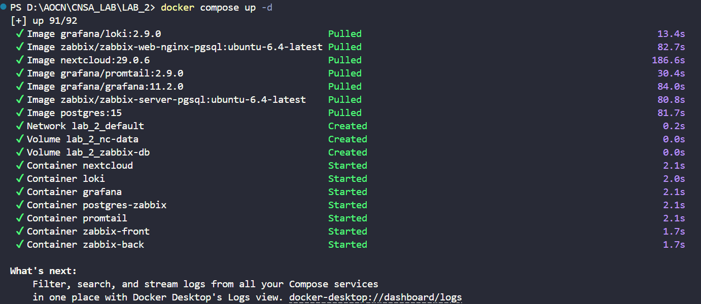

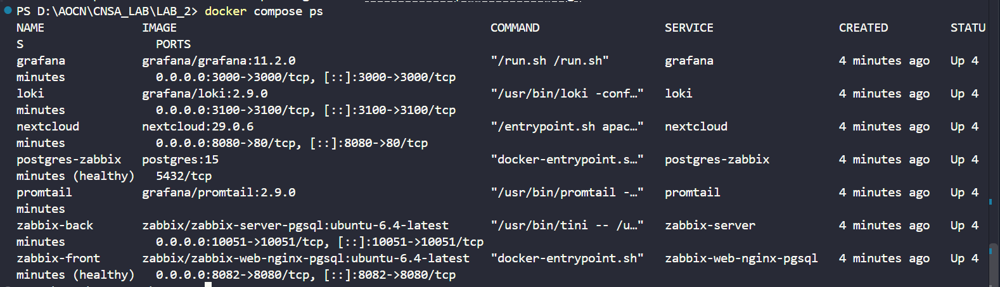

### 1.2 Инициализация Nextcloud

После запуска контейнеров был открыт веб-интерфейс Nextcloud по адресу `http://localhost:8080`. На данном этапе была выполнена первоначальная настройка приложения и создана учётная запись администратора.

Далее была проверена директория, в которой Nextcloud сохраняет собственные журналы:

```powershell
docker exec nextcloud ls -la /var/www/html/data
docker exec nextcloud tail -n 5 /var/www/html/data/nextcloud.log
```

В директории присутствует файл `nextcloud.log`. В нём уже имеются записи приложения, представленные в формате JSON.

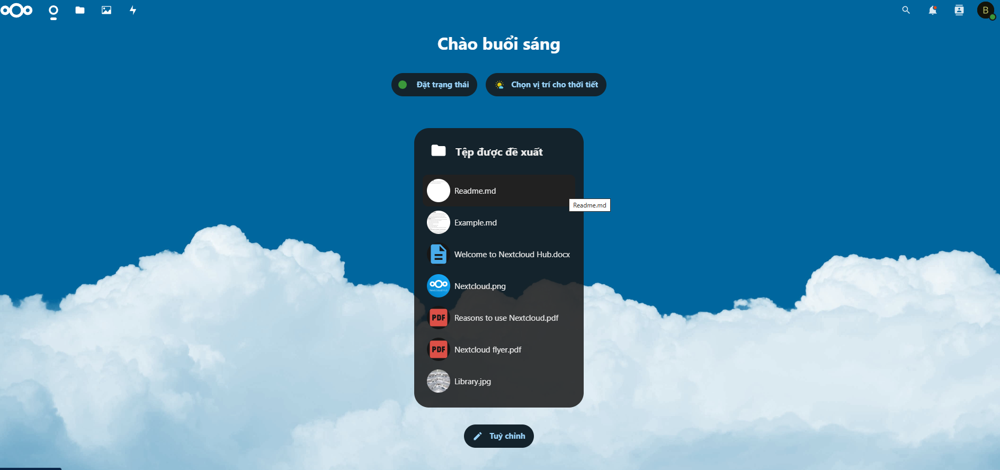

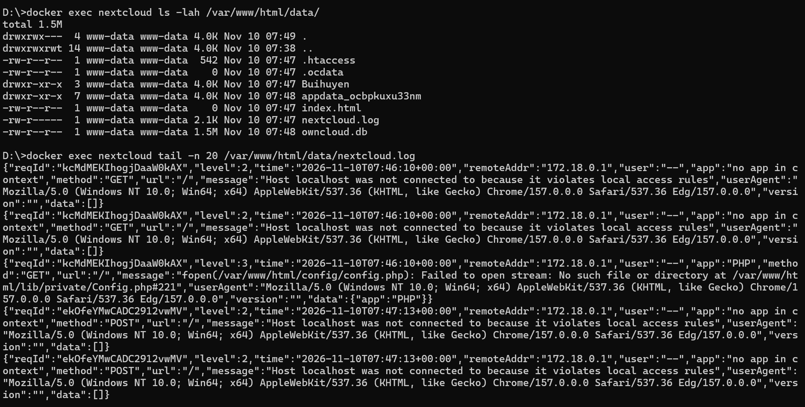

### 1.3 Проверка логирования
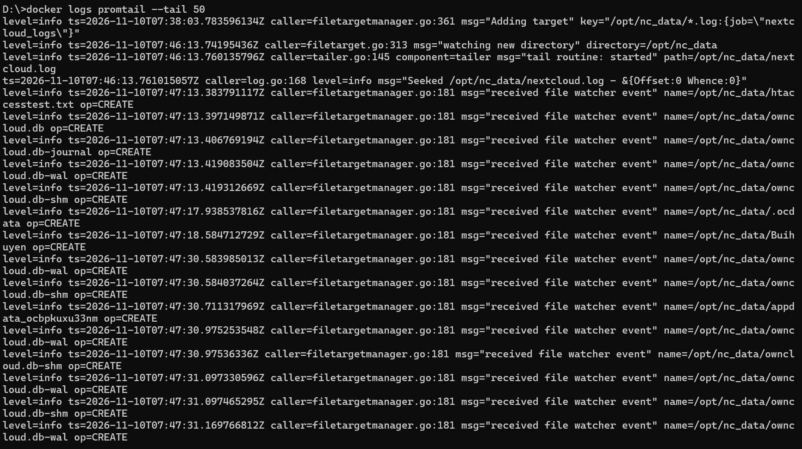 
### 1.4 Проверка получения логов Promtail

После того как файл журнала был найден, была проверена работа Promtail. Для этого из его логов была отфильтрована информация, содержащая сообщение `Seeked`:

```powershell
docker logs promtail 2>&1 | Select-String "Seeked"
```

В выводе присутствует строка с указанием `/opt/nc_data/nextcloud.log`. Это показывает, что Promtail обнаружил файл журнала и начал отслеживать его содержимое.

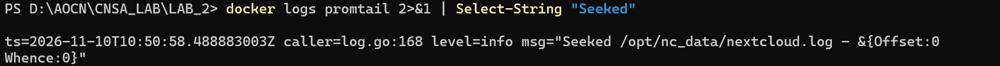


## 2. Мониторинг

### 2.1 Импорт шаблона в Zabbix

Для настройки мониторинга был открыт веб-интерфейс Zabbix по адресу `http://localhost:8082`. Для авторизации использовались данные `Admin` и `zabbix`.

В разделе **Data collection → Templates** был импортирован файл `template.yml`.

Импортированный шаблон предназначен для проверки состояния Nextcloud через HTTP-запрос к `/status.php`. Полученный результат преобразуется в значения `healthy` и `unhealthy`. Для состояния `unhealthy` предусмотрено срабатывание триггера `Nextcloud is in maintenance mode`.

Сначала был проверен экран предварительного просмотра импортируемого шаблона.

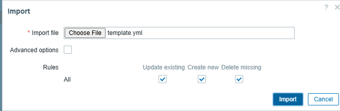

После подтверждения операции шаблон появился в списке доступных шаблонов Zabbix.

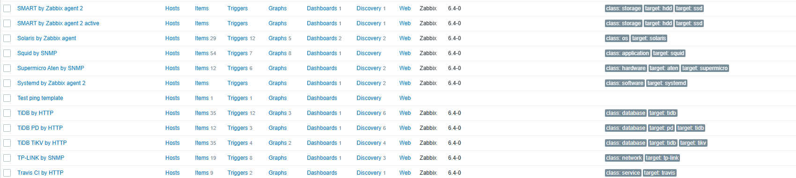

### 2.2 Добавление `nextcloud` в доверенные домены

Чтобы Zabbix мог обращаться к Nextcloud по имени контейнера, это имя было добавлено в список доверенных доменов приложения.

Для изменения конфигурации использована команда:

```powershell
docker exec -u www-data nextcloud php occ config:system:set trusted_domains 1 --value="nextcloud"
```

После выполнения команды имя контейнера `nextcloud` стало разрешённым для обращений внутри Docker-сети.

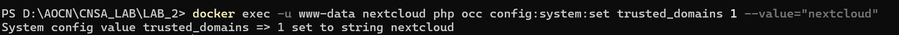

### 2.3 Создание хоста Nextcloud

После подготовки шаблона в Zabbix был создан новый хост.

В разделе **Data collection → Hosts** указаны следующие параметры:

- Host name: `nextcloud`
- Visible name: `nextcloud`
- Templates: `Test ping template`
- Host groups: `Applications`

В качестве имени хоста использовано именно `nextcloud`, поскольку оно соответствует имени контейнера, по которому сервис доступен внутри Docker-сети.

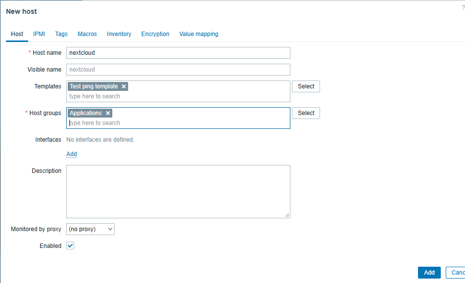

### 2.4 Получение данные

После создания хоста и подключения шаблона была открыта страница **Monitoring → Latest data**.

Для элемента `Nextcloud: ping service` появилось значение `healthy`.

Полученный результат показывает, что Zabbix успешно выполняет проверку Nextcloud и получает корректный ответ от сервиса.

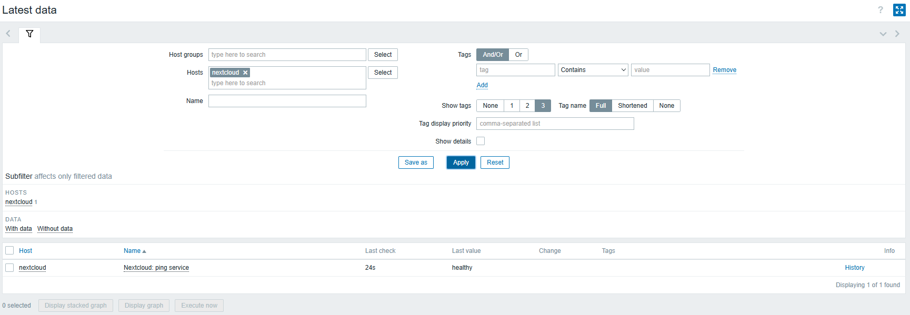

### 2.5 Проверка срабатывания триггера

Для проверки настроенного триггера был временно включён режим обслуживания Nextcloud:

```powershell
docker exec -u www-data nextcloud php occ maintenance:mode --on
curl.exe http://localhost:8080/status.php
```

После выполнения команды `status.php` вернул значение `"maintenance":true`.

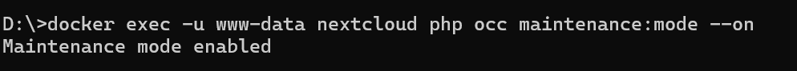

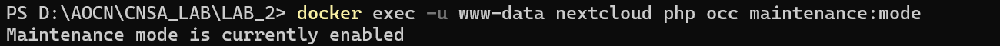

После изменения состояния Nextcloud в Zabbix была обнаружена проблема `Nextcloud is in maintenance mode` с уровнем важности **Disaster**.

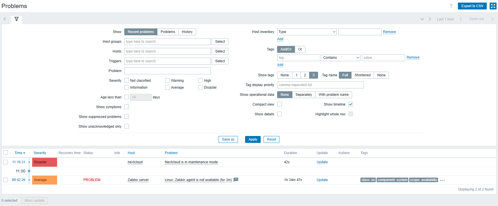

Затем режим обслуживания был отключён:

```powershell
docker exec -u www-data nextcloud php occ maintenance:mode --off
```

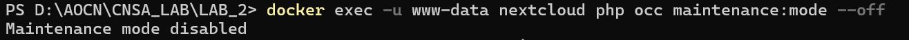

После восстановления нормального состояния Nextcloud значение снова стало `healthy`, а ранее созданная проблема автоматически перешла в состояние **RESOLVED**.

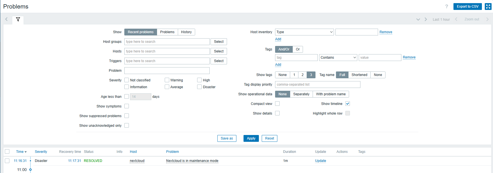

## 3. Визуализация

### 3.1 Установка и активация Zabbix-плагина

Для получения данных Zabbix в Grafana сначала был установлен специальный плагин:

```powershell
docker exec -it grafana bash -c "grafana cli plugins install alexanderzobnin-zabbix-app 4.5.4"
docker restart grafana
```

После перезапуска контейнера Grafana плагин был найден в разделе **Administration → Plugins** и активирован.

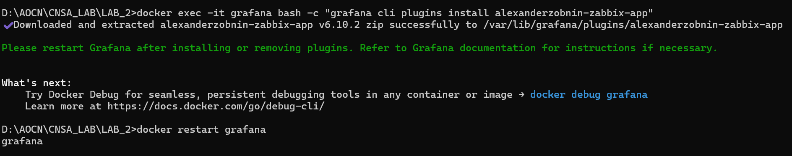

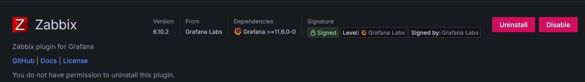

### 3.2 Добавление источника данных Loki

Следующим этапом было подключение Loki к Grafana.

В разделе **Connections → Data sources** был создан источник данных с именем `loki`.

В качестве адреса сервиса указан:

`http://loki:3100`

После заполнения параметров была выполнена проверка подключения с помощью **Save & Test**.

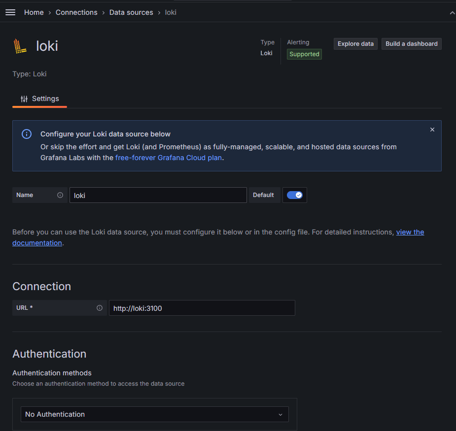

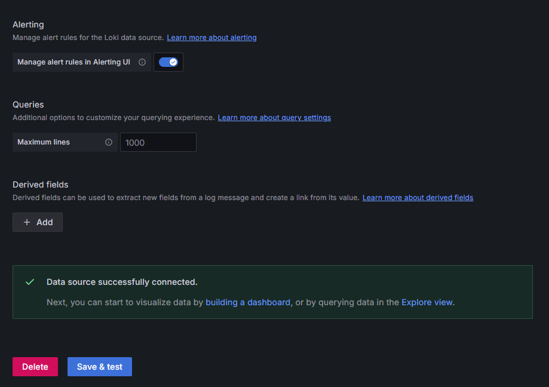

### 3.3 Подключение Zabbix

После Loki был настроен второй источник данных — Zabbix.

Для него использованы следующие параметры:

- Name: `alexanderzobnin-zabbix-datasource`
- URL: `http://zabbix-front:8080/api_jsonrpc.php`
- Username: `Admin`
- Password: `zabbix`

Подключение было сохранено и проверено через **Save & Test**. Проверка завершилась успешно.

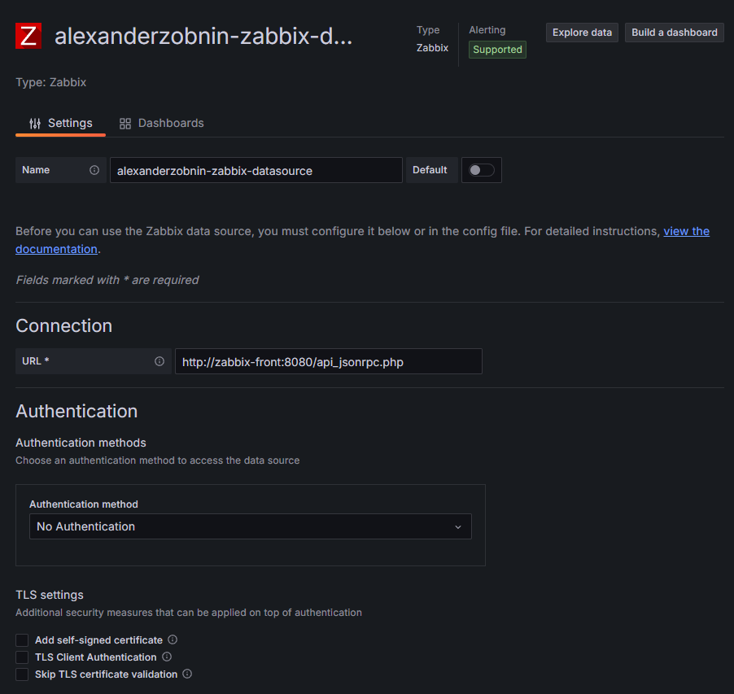

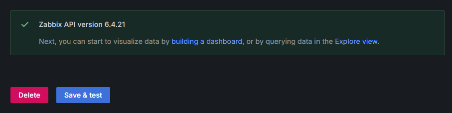

### 3.4 Просмотр логов через Explore

Для проверки работы Loki был открыт раздел **Explore** в Grafana и выбран источник `loki`.

В качестве запроса использовался следующий LogQL-запрос:

```text
{job="nextcloud_logs"}
```

После выполнения запроса Grafana отобразила записи, полученные из Loki. Также в интерфейсе был представлен график количества найденных логов за выбранный период.

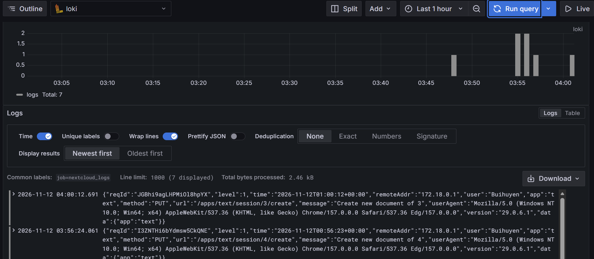

### 3.5 Проверка данных Zabbix в Explore

Затем была выполнена аналогичная проверка источника `alexanderzobnin-zabbix-datasource`.

Для запроса были выбраны:

- Query type: `Text`
- Group: `Applications`
- Host: `nextcloud`
- Item: `Nextcloud: ping service`

В таблице истории можно увидеть несколько состояний сервиса. В обычном состоянии Nextcloud возвращает `healthy`. Во время включённого maintenance mode появлялось значение `unhealthy`, после отключения режима состояние снова становилось `healthy`.

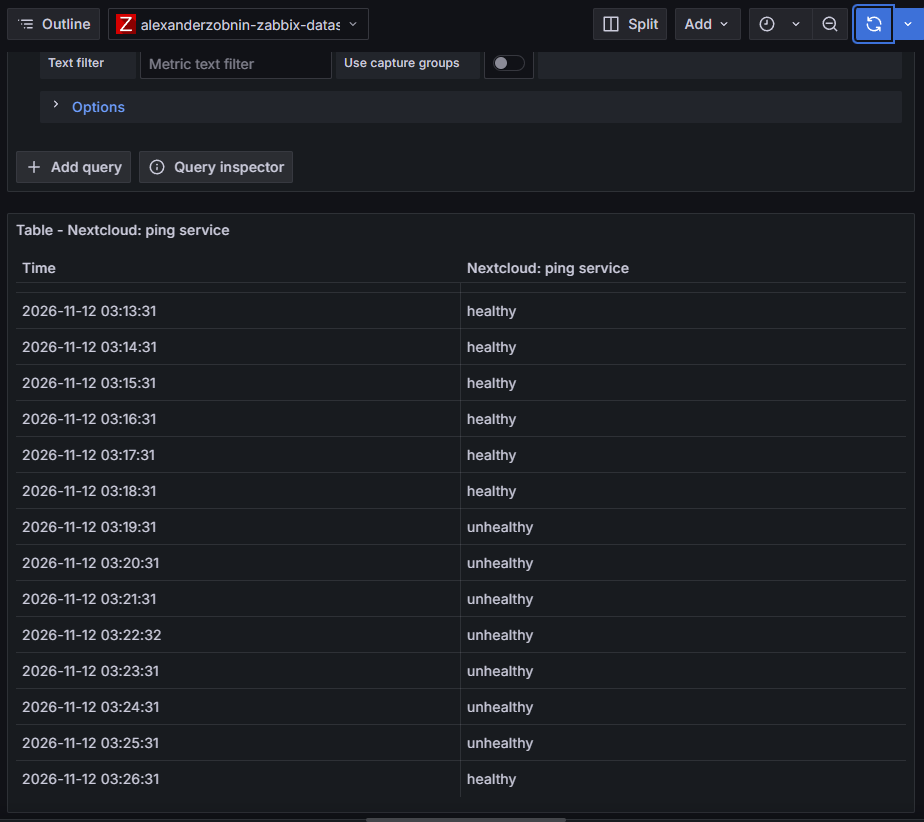


## 4. Задание

В соответствии с заданием был создан дашборд `Nextcloud Logs`, содержащий две панели с информацией из Zabbix и Loki.

### 4.1 Панель `Nextcloud Logs`

Первая панель построена на основе данных Loki.

Используемый запрос:

```text
{job="nextcloud_logs"}
```

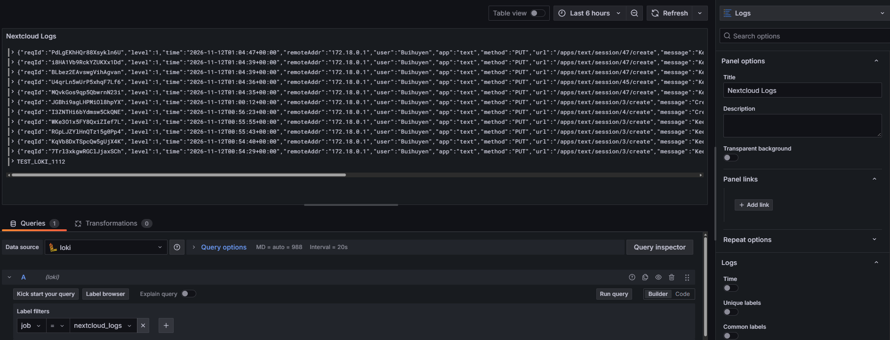

### 4.2 Панель `Nextcloud status`

Вторая панель использует источник данных Zabbix и тип визуализации **Stat**.

В панели отображается последнее полученное состояние Nextcloud. Для более понятного представления результатов настроено сопоставление значений:

- `healthy` → `Nextcloud is: HEALTHY`
- `unhealthy` → `Nextcloud is: UNHEALTHY`

Таким образом, состояние сервиса можно определить непосредственно по панели Grafana.

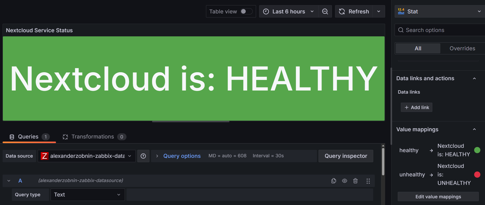

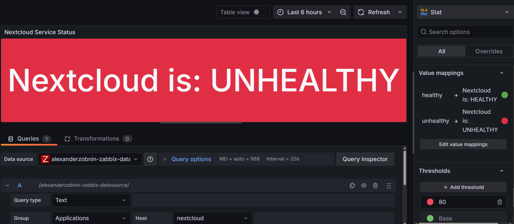

### 4.3 Итоговый дашборд

В результате был получен единый дашборд, в котором одновременно отображаются текущее состояние Nextcloud и его журнальные записи.

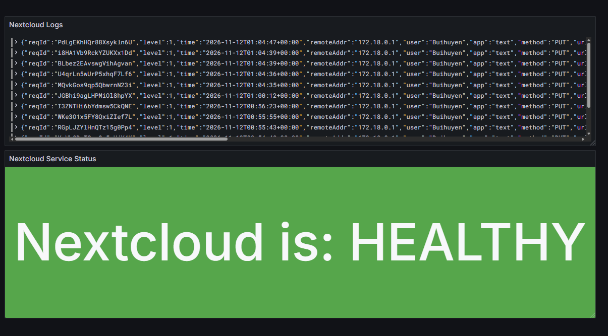

## 5. Ответы на вопросы

### 5.1 Чем SLO отличается от SLA?

`SLO (Service Level Objective)` - это целевой показатель уровня качества сервиса, который организация устанавливает для себя. Например, можно поставить цель обеспечить доступность сервиса на уровне 99,9% в течение месяца.

`SLA (Service Level Agreement)` - это уже официальное соглашение между поставщиком услуги и клиентом. В нём фиксируются конкретные гарантии по доступности, времени реакции, качеству обслуживания и другие условия. Если эти условия нарушаются, договор может предусматривать определённые последствия, например компенсацию.


### 5.2 Чем отличается инкрементальный бэкап от дифференциального?
Главное отличие заключается в том, с какого момента определяются изменения, которые нужно сохранить.

`Инкрементальный бэкап` сохраняет только те данные, которые изменились после предыдущей резервной копии. Поэтому каждый следующий инкрементальный бэкап обычно содержит меньше данных и выполняется быстрее.

`Дифференциальный бэкап` сохраняет все изменения, которые произошли после последнего полного бэкапа. Поэтому его размер со временем увеличивается до создания следующего полного бэкапа.

Например, если в понедельник был создан полный бэкап, во вторник изменилось 10 файлов, а в среду ещё 5:
- во вторник инкрементальный бэкап сохранит 10 файлов;
- в среду инкрементальный сохранит только 5 новых файлов;
- в среду дифференциальный сохранит все 15 изменённых файлов.
Главное различие заключается в точке отсчёта: инкрементальный бэкап ориентируется на последнюю копию, а дифференциальный на последний полный бэкап.

### 5.3 В чём разница между мониторингом и observability?

Мониторинг - это постоянное наблюдение за заранее определёнными показателями системы. Он позволяет быстро определить, что система работает неправильно. 

Observability - более широкий подход, который позволяет не только обнаружить проблему, но и понять её причину. Для этого используются различные источники данных, прежде всего метрики, логи и трассировки.

Например, мониторинг может показать, что время ответа сервиса резко увеличилось. Observability позволяет дополнительно посмотреть логи и трассировку запроса и определить, какой именно компонент стал причиной задержки.

## Вывод

В ходе лабораторной работы была настроена система мониторинга и анализа состояния тестового сервиса Nextcloud. Для контроля доступности и состояния сервиса использовался Zabbix, а для сбора и просмотра журналов - связка Promtail, Loki и Grafana.

В результате удалось настроить передачу логов Nextcloud через Promtail в Loki и подключить Loki к Grafana. В Grafana были проверены получение и отображение реальных записей из `nextcloud.log`, а также настроен запрос по label `job="nextcloud_logs"`. Дополнительно был создан dashboard, объединяющий информацию о состоянии сервиса и его логах.

Таким образом, в рамках работы был получен практический опыт настройки мониторинга и централизованного сбора логов, а также показано различие между мониторингом состояния сервиса и анализом его журналов.
